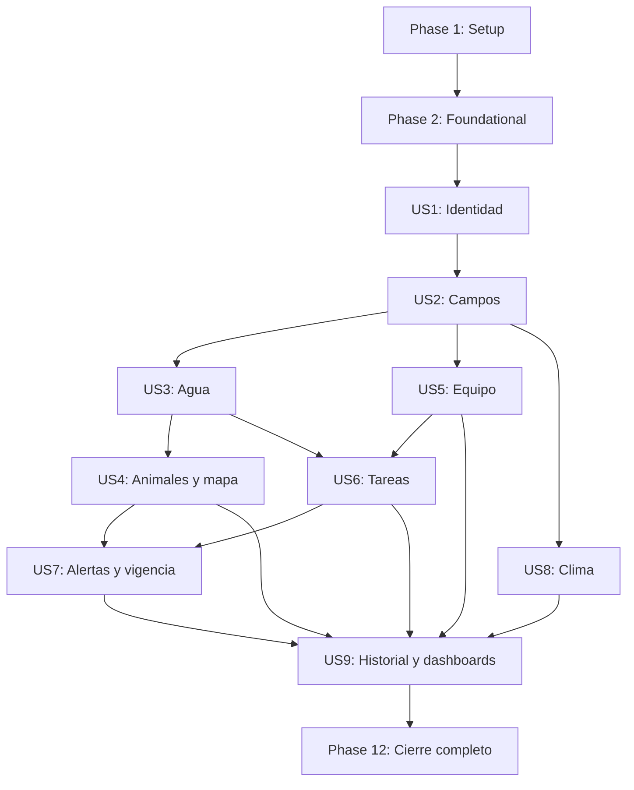

# Tasks: Monitoreo remoto de bebederos — MVP

**Input**: Documentos de diseño en `specs/001-monitoreo-bebederos/`.
**Prerequisites**: [plan.md](plan.md), [spec.md](spec.md), [research.md](research.md), [data-model.md](data-model.md), [contrato API](contracts/api.md), [contrato UI](contracts/ui.md) y [quickstart.md](quickstart.md).
**Estado**: Fases 1 y 2 implementadas y verificadas (T001–T020, 2026-10-13); evidencia en [validation/baseline.md](validation/baseline.md) y [validation/foundational.md](validation/foundational.md). T021–T143 pendientes. La generación con `$speckit-tasks` no autoriza implementación, envíos ni despliegues.
**Tests**: Incluir validaciones significativas de los escenarios y criterios de éxito exigidos por la especificación y la estrategia de pruebas acordada en el plan; no introducir TDD general ni pruebas que solo reproduzcan implementación. Definir los casos de contrato/reglas antes de la funcionalidad y confirmar que fallan por el comportamiento pendiente, no por fallos del entorno; ejecutar al integrar cada historia.
**Organization**: Historias US1–US9 en el orden P1–P9. Todas pertenecen al MVP; US1 sola es un primer incremento demostrable, no el MVP completo.

## Format: `[ID] [P?] [Story] Description`

Cada tarea usa `- [ ] TNNN`, ruta concreta y etiqueta de historia cuando corresponde. `[P]` significa archivos distintos y trabajo paralelo dentro de una tanda cuyos prerrequisitos ya terminaron; no autoriza saltar dependencias ni implica delegación automática. Las tareas sin `[P]` se ejecutan secuencialmente salvo indicación explícita en dependencias.

## Path Conventions

Backend, modelos, credenciales, persistencia, API y procesos bajo `database/`. Interfaz y consultas HTTP bajo `frontend/mi-proyecto-shadcn/`. Documentación/evidencias bajo `specs/001-monitoreo-bebederos/`. Rutas sin `/` inicial son relativas a la raíz del repositorio; las carpetas nuevas se crean únicamente cuando se implemente la tarea.

Las restricciones entre comillas se toman literalmente de `data-model.md` o `contracts/api.md`; el conjunto completo de campos/convenciones de esos documentos aplica a cada modelo, aunque la tarea destaque solo sus validaciones particulares. Nombres de campos wire en inglés siguen el contrato API; las columnas/modelos pueden usar nombres coherentes documentados sin cambiar las respuestas acordadas.

Las migraciones de Phase 2 crean todo el esquema relacional para que autorización, baja y revocación no dependan de fases futuras. Los modelos y servicios de cada dominio se incorporan en su historia. US1 usa invitaciones y campos preparados por fixtures; la emisión y gestión real se añade en US5. No usar endpoints simulados ni conceder accesos temporales para cerrar una fase.

---

## Phase 1: Setup — Preparación del proyecto existente

**Goal**: Preparar herramientas y referencias, sin reemplazar React/Vite/Tailwind ni Node/Express/MySQL.

**Independent Test**: Instalación reproducible y herramientas separadas por proyecto; baseline visual documentado.

- [X] T001 Registrar estado del código, rutas/importaciones actuales y capturas de los paneles dueño/peón en `specs/001-monitoreo-bebederos/validation/baseline.md`, señalando cambios necesarios sin rediseño general.
- [X] T002 Agregar únicamente las dependencias de backend del plan y scripts futuros de migración/worker/pruebas en `database/package.json` y `database/package-lock.json`; conservar Express, Sequelize, mysql2, bcrypt y dotenv existentes.
- [X] T003 [P] Agregar React Router, TanStack Query y herramientas de prueba en `frontend/mi-proyecto-shadcn/package.json` y `frontend/mi-proyecto-shadcn/package-lock.json`, conservando versiones existentes y JavaScript/JSX.
- [X] T004 [P] Documentar y validar variables de `quickstart.md` en `database/.env.example`, `database/config/env.js` y `.gitignore`; secretos de sesión y cola separados, SMTP y clima comercial solo en backend, configuración de teselas pública sin credenciales privadas.
- [X] T005 [P] Configurar Vitest/Supertest y MySQL de pruebas en `database/vitest.config.js` y `database/tests/helpers/testDatabase.js`, impidiendo usar o borrar la base operativa; preparar reloj y proveedores sustituibles.
- [X] T006 [P] Configurar Vitest, jsdom y React Testing Library en `frontend/mi-proyecto-shadcn/vitest.config.js` y `frontend/mi-proyecto-shadcn/tests/setup.js`.
- [X] T007 Configurar Playwright con proyectos de 375, 768 y 1280 px en `frontend/mi-proyecto-shadcn/playwright.config.js` y `frontend/mi-proyecto-shadcn/tests/e2e/helpers.js`, usando cuentas y datos de prueba identificados.
- [X] T008 Configurar proxy de desarrollo `/api` hacia Express en `frontend/mi-proyecto-shadcn/vite.config.js`; documentar mismo origen HTTPS y fallback SPA que no capture errores API en `database/deployment/README.md`.

**Checkpoint**: Validar el criterio independiente de esta fase y mantener funcionando las fases ya integradas. Casillas se marcan solo al terminar y verificar la implementación, nunca durante generación de tareas.

---

## Phase 2: Foundational — Base compartida bloqueante

**Goal**: Establecer persistencia, contrato HTTP, autorización y soporte durable antes de implementar historias.

**Independent Test**: API importable sin arranque destructivo; migraciones repetibles; errores/paginación uniformes; dependencias compartidas listas.

- [X] T009 Separar construcción Express de inicio del servidor en `database/app.js` y `database/server.js`; retirar `sync({ force: true })`, no usar alter automático y mantener todos los endpoints antiguos privados o deshabilitados hasta adaptar sus permisos.
- [X] T010 Crear ejecutor Umzug en `database/scripts/migrate.js` y registro de modelos en `database/models/index.js`; convertir cada versión de esquema en migración explícita, nunca recrear tablas al iniciar.
- [X] T011 Crear migración de tablas compartidas Cuenta, Establecimiento, Asignación, Invitación, CampoInvitación, TokenIdentidad y Sesión en `database/migrations/001-identity-fields.js`, según `data-model.md`: "Rol obligatorio `owner` o `worker`, nunca ambos. Correo único." y "Par campo/peón único"; permitir fixtures de invitación antes de US5.
- [X] T012 Crear esquema de recursos y telemetría en `database/migrations/002-monitoring-fields.js`: Bebedero, Animal, LecturaAgua, PosiciónAnimal, PosiciónBebedero, estados de monitoreo y VisitaEstimada; "Registro inmutable; claveFuente única.", "Una fila por animal.", "Una fila por bebedero." y "una visita por posición/entrada"; relaciones sin cascadas que borren hechos.
- [X] T013 Crear tablas de Tarea, EventoTarea, Alerta, NotificaciónInterna, EventoHistorial, CorreoPendiente, ClimaCache y EstadoProceso en `database/migrations/003-workflow-fields.js` con todas las columnas/índices de `data-model.md`; disponer de estas relaciones vacías para guardas de baja y revocación antes de US6/US7.
- [X] T014 [P] Implementar errores JSON, validación estricta Zod y paginación en `database/middleware/errors.js`, `database/middleware/validate.js` y `database/services/pagination.js`: page=1, limit=50, máximo 100; 401/403/404/409/422/429/503 según contrato y sin stack/SQL/secretos.
- [X] T015 [P] Implementar autorización reutilizable por cuenta/campo/recurso en `database/middleware/authorization.js` y `database/services/access.service.js` mediante consultas SQL sobre esquema migrado, sin depender de modelos de historias futuras; dueño solo propietario, peón asignación activa, 404 fuera de alcance.
- [X] T016 [P] Crear modelo y escritura transaccional de eventos en `database/models/HistoryEvent.model.js` y `database/services/historyWriter.service.js`, respetando "Inmutable y filtrable; nunca guardar secretos." y "actorId nullable"; la consulta se añade en US9.
- [X] T017 [P] Crear CorreoPendiente, cifrado y cola SMTP en `database/models/MailOutbox.model.js`, `database/services/mail.service.js` y `database/workers/mail.worker.js`: "Payload cifrado con secreto separado; máximo tres reintentos automáticos. Retirar payload al enviar o vencer el token."; esperas 1/2/4 min y pruebas con proveedor simulado.
- [X] T018 Crear proceso independiente y EstadoProceso en `database/workers/index.js`, `database/models/WorkerState.model.js` y `database/services/workerHealth.service.js`: "Señal de salud persistente sin secretos; no sustituye marcación individual de muestras."; ciclo 5 s, sin solapar ciclos, parada limpia, retomar pendientes; habilitar trabajos por historia implementada.
- [X] T019 [P] Crear cliente fetch con cookie, CSRF y errores de contrato en `frontend/mi-proyecto-shadcn/src/services/api.js`, y QueryClient con claves por cuenta/alcance en `frontend/mi-proyecto-shadcn/src/lib/queryClient.js`; sin tokens/roles de autorización en localStorage.
- [X] T020 [P] Crear estados de carga/error/vacío y confirmación accesible en `frontend/mi-proyecto-shadcn/src/components/AsyncState.jsx` y `frontend/mi-proyecto-shadcn/src/components/ConfirmAction.jsx`; reutilizar componentes/estilos y no mostrar valores inventados.

**Checkpoint**: Validar el criterio independiente de esta fase y mantener funcionando las fases ya integradas. Casillas se marcan solo al terminar y verificar la implementación, nunca durante generación de tareas.

---

## Phase 3: User Story 1 — Acceso con rol único (Priority: P1)

**Goal**: Habilitar registro dueño, ingreso peón por invitación, sesión, verificación, recuperación y acceso por rol.

**Independent Test**: Con fixtures de dos dueños, campos, asignaciones e invitaciones preparados en MySQL, registrar/verificar dueño, crear peón invitado, aceptar explícitamente y rechazar rol incompatible, accesos ajenos y sesiones invalidadas.

### Tests e implementación

- [ ] T021 [P] [US1] Definir pruebas de contrato de auth/csrf/register/login/me/logout/verify/resend-verification/forgot/reset/profile y aceptación mínima en `database/tests/contract/auth.test.js`, cubriendo respuestas genéricas, rol no elegible por cliente y datos sensibles excluidos.
- [ ] T022 [P] [US1] Definir casos de identidad, cookies/CSRF, expiración, invalidación y aislamiento con fixtures en `database/tests/integration/auth.test.js`; un enlace de peón verifica correo sin conceder asignaciones hasta aceptar.
- [ ] T023 [US1] Implementar Cuenta, TokenIdentidad y sesiones SQL en `database/models/Account.model.js`, `database/models/IdentityToken.model.js` y `database/services/session.service.js`: "Rol obligatorio `owner` o `worker`, nunca ambos. Correo único.", "Perfil editable no cambia rol/correo en el MVP.", "Verificación 24 horas; recuperación 30 minutos; único y de un solo uso."; normalizar correo según convenciones.
- [ ] T024 [US1] Crear esquemas de registro/login/perfil en `database/services/auth.schemas.js`: "Contraseña de al menos 10 caracteres y máximo 72 bytes UTF-8 para bcrypt."; id positivo, role/ownerId/telemetría no aceptados; serializers nunca exponen hash.
- [ ] T025 [US1] Configurar cookies HttpOnly/SameSite=Lax/Secure producción, 24 h, regeneración y CSRF en `database/middleware/session.js`, `database/middleware/csrf.js` y `database/middleware/security.js`; Helmet y límites generales 600/min e identidad/envío 30/15 min por IP.
- [ ] T026 [US1] Implementar registro/login/logout/verificación/reenvío/recuperación y perfil en `database/services/auth.service.js`, encolando correo duradero; invalidar tokens anteriores en reenvío/recuperación y todas las sesiones al cambiar contraseña.
- [ ] T027 [US1] Implementar validación de token, preview público y aceptación transaccional de invitación preparada por fixture en `database/services/invitationAcceptance.service.js`: "Token único; siete días exactos.", correo coincide, worker obligatorio, campos vigentes, repetición idempotente sin reactivar acceso revocado; emisión/administración queda en US5.
- [ ] T028 [US1] Montar rutas de auth, perfil y preview/accept bajo `/api/v1` en `database/router/auth.router.js`, `database/router/profile.router.js` y `database/router/invitationAcceptance.router.js`; retirar o adaptar entradas antiguas inseguras en `database/router/user.router.js` y `database/router/perfil.router.js`.
- [ ] T029 [P] [US1] Adaptar login/registro existentes y crear verificar/olvidé/restablecer en `frontend/mi-proyecto-shadcn/src/pages/autorizationModule/login-interface/login.jsx`, `frontend/mi-proyecto-shadcn/src/pages/autorizationModule/register-interface/register.jsx`, `frontend/mi-proyecto-shadcn/src/pages/autorizationModule/IdentityActions.jsx`; sin selección pública de peón.
- [ ] T030 [P] [US1] Crear recorrido público de enlace invitación, creación/login y aceptación explícita en `frontend/mi-proyecto-shadcn/src/pages/autorizationModule/InvitationAccess.jsx`; limpiar token de URL tras uso y manejar dueño incompatible/enlace retirado/vencido sin filtrar campos privados.
- [ ] T031 [US1] Integrar AuthProvider, rutas protegidas y navegación por rol en `frontend/mi-proyecto-shadcn/src/hooks/useAuth.js`, `frontend/mi-proyecto-shadcn/src/components/ProtectedRoute.jsx`, `frontend/mi-proyecto-shadcn/src/App.jsx` y `frontend/mi-proyecto-shadcn/src/main.jsx`; corregir casing/importaciones e ignorar rol de localStorage para autorización.
- [ ] T032 [US1] Implementar perfil con nombre editable, correo/rol de solo lectura y logout en `frontend/mi-proyecto-shadcn/src/pages/Profile/Profile.jsx`; limpiar QueryClient y recursos de cuenta anterior al cerrar/cambiar sesión.
- [ ] T033 [US1] Verificar recorrido de registro, verificación, sesión, invitación fixture, rechazo de dueño y recuperación en `frontend/mi-proyecto-shadcn/tests/e2e/auth.spec.js`, con captura SMTP de prueba y enlaces de un uso.
- [ ] T034 [US1] Ejecutar casos de US1 y SC-002 de identidad, registrar cookies, sesión reiniciada y ausencia de datos ajenos en `specs/001-monitoreo-bebederos/validation/US1.md`; no declarar cubiertos mapas/recursos aún no implementados.

**Checkpoint**: Validar el criterio independiente de esta fase y mantener funcionando las fases ya integradas. Casillas se marcan solo al terminar y verificar la implementación, nunca durante generación de tareas.

---

## Phase 4: User Story 2 — Gestión de establecimientos (Priority: P2)

**Goal**: Crear, editar, listar y retirar campos propios; agrupar recursos y configurar antigüedad por campo.

**Independent Test**: Crear dos campos vacíos, cambiar administración/límite, ver cantidades cero; preparar dependencias mediante fixtures y demostrar baja bloqueada o histórica sin perder accesos de otro dueño.

### Tests e implementación

- [ ] T035 [P] [US2] Definir pruebas de GET/list/create/detail/PATCH/DELETE farms en `database/tests/contract/farms.test.js`, con validaciones y escritura prohibida al peón; usar tablas vacías/fixtures para dependencias futuras.
- [ ] T036 [P] [US2] Definir pruebas de pertenencia, cantidades activas, configuración independiente y baja con recursos/tareas en `database/tests/integration/farms.test.js`.
- [ ] T037 [US2] Implementar Establecimiento en `database/models/Farm.model.js`: "Un dueño; nombre no vacío; coordenadas válidas; superficie ≥ 0; límite entero positivo, 180 predeterminado; zona IANA válida."; latitud −90 a 90/longitud −180 a 180, hectáreas visibles y deletedAt.
- [ ] T038 [US2] Implementar CRUD, filtro por permisos y cantidades derivadas en `database/services/farm.service.js`, sin permitir ownerId del cliente; guardas SQL transaccionales sobre tablas ya migradas para recursos/tareas/asignaciones/invitaciones de historias posteriores.
- [ ] T039 [US2] Implementar baja lógica y desactivación de asignaciones/campos invitados en `database/services/farmRetirement.service.js`, rechazando animales/bebederos activos o tareas abiertas; conservar eventos y resolver alertas si existen.
- [ ] T040 [US2] Implementar validación/configuración del límite y notificación durable de reevaluación, además de invalidar caché climática al cambiar ubicación, en `database/services/farmSettings.service.js`; ejecutor de alertas llega en US7.
- [ ] T041 [US2] Montar rutas de campos y settings en `database/router/farms.router.js` con serializers `areaHa`, `staleMinutes`, timezone y detalle según `contracts/api.md`.
- [ ] T042 [P] [US2] Crear lista/detalle/formulario y confirmación de eliminación con dependencias en `frontend/mi-proyecto-shadcn/src/pages/Establecimientos/Establecimientos.jsx` y `frontend/mi-proyecto-shadcn/src/pages/Establecimientos/FarmForm.jsx`.
- [ ] T043 [US2] Crear selector de campos y hook de alcance en `frontend/mi-proyecto-shadcn/src/components/FarmSelector.jsx` y `frontend/mi-proyecto-shadcn/src/hooks/useFarmScope.js`; peón consulta solo asignados y cero campos no impide perfil/invitaciones.
- [ ] T044 [US2] Integrar `/farms`, selección y configuración en `frontend/mi-proyecto-shadcn/src/components/AppNavigation.jsx` y `frontend/mi-proyecto-shadcn/src/App.jsx`, preservando patrón visual dueño/peón.
- [ ] T045 [US2] Verificar US2, errores de superficie/coordenadas/límite, confirmación y baja con fixtures mediante `frontend/mi-proyecto-shadcn/tests/e2e/farms.spec.js` y registrar resultados en `specs/001-monitoreo-bebederos/validation/US2.md`.

**Checkpoint**: Validar el criterio independiente de esta fase y mantener funcionando las fases ya integradas. Casillas se marcan solo al terminar y verificar la implementación, nunca durante generación de tareas.

---

## Phase 5: User Story 3 — Gestión y monitoreo de bebederos (Priority: P3)

**Goal**: Consultar agua individual y ubicación, gestionar metadatos de bebederos y procesar lecturas sin recargar.

**Independent Test**: Usar agua 0/19/20/50/51/100 e inválida; incorporar muestras desde fixture/comando y verificar valor/categoría/fecha automáticos y rechazo de modificaciones por ambos roles.

### Tests e implementación

- [ ] T046 [P] [US3] Definir casos de límites de porcentaje, ausencia, muestras iguales legítimas y orden temporal en `database/tests/unit/water.test.js`, incluyendo 0, 20, 50, 100 y fuera de rango.
- [ ] T047 [P] [US3] Definir contrato troughs list/detail/create/delete y rechazo de payload de medición/GPS en `database/tests/contract/troughs.test.js`.
- [ ] T048 [US3] Implementar Bebedero y EstadoMonitoreoBebedero en `database/models/Trough.model.js` y `database/models/TroughState.model.js`: "Un campo; capacidad > 0; origen ubicación `administrative` o `device`. Estados iniciales Operativo, En mantenimiento o Fuera de servicio, sin confundirlos con categoría de agua." y "Una fila por bebedero."; coordenadas ambas presentes o ambas ausentes.
- [ ] T049 [US3] Implementar LecturaAgua y PosiciónBebedero en `database/models/WaterReading.model.js` y `database/models/TroughPosition.model.js`: "Registro inmutable; claveFuente única.", "GPS de dispositivo de solo lectura cuando esté disponible." y porcentaje entre 0 y 100; fechas recibidas independientes de metadatos.
- [ ] T050 [US3] Implementar alta/consulta/baja, serializers y guardas de tareas abiertas en `database/services/trough.service.js`; historial y última lectura persisten tras baja; ningún rol escribe agua o coordenadas de origen device.
- [ ] T051 [US3] Implementar categorías Normal >50, Bajo 20–50 inclusivo y Crítico <20 y última lectura válida en `database/services/water.service.js`; inválidas no sustituyen datos válidos, ausencia null nunca cero.
- [ ] T052 [US3] Implementar procesamiento de muestras y posiciones de bebedero por fecha/id, lotes de 500 y transacciones con marcación persistente en `database/services/waterProcessing.service.js`; conservar válidas fuera de orden como historial sin cambiar actual; clasificar futuras/invalidas; bloquear recurso/campo contra otros procesos.
- [ ] T053 [US3] Registrar trabajo de agua cada 5 s en `database/workers/monitor.worker.js` y `database/workers/index.js`; retomar pendientes tras reinicio y guardar cambios históricos sin usuarios conectados, dejando eventos consumibles por US7.
- [ ] T054 [US3] Montar rutas de bebederos con alcance y protección en `database/router/troughs.router.js`; retirar/adaptar rutas antiguas en `database/router/bebederos.router.js` para impedir bypass de telemetría o permisos.
- [ ] T055 [P] [US3] Crear listado/ficha y formulario administrativo de alta con capacidad/ubicación/unidades en `frontend/mi-proyecto-shadcn/src/pages/Bebederos/Bebederos.jsx` y `frontend/mi-proyecto-shadcn/src/pages/Bebederos/TroughForm.jsx`; eliminación confirmada, categoría/fecha visibles, agua sin controles de edición.
- [ ] T056 [US3] Implementar consultas periódicas 10 s, reconexión/foco, invalidación y aviso de red en `frontend/mi-proyecto-shadcn/src/hooks/useLiveQuery.js` y `frontend/mi-proyecto-shadcn/src/hooks/useTroughs.js`; valores anteriores fechados, permisos denegados retiran contenido.
- [ ] T057 [US3] Crear herramienta de muestras y fixtures limitados a desarrollo/pruebas en `database/scripts/sample.js` y `database/tests/fixtures/water.js`, sin API pública de escritura; admitir clavesFuente estables y valores repetidos de distintos registros.
- [ ] T058 [US3] Verificar reinicios, muestras duplicadas/fuera de orden, procesamiento concurrente y conservación tras baja en `database/tests/integration/waterProcessing.test.js`.
- [ ] T059 [US3] Demostrar US3, actualizaciones automáticas y rechazo de nivel/GPS manual en `frontend/mi-proyecto-shadcn/tests/e2e/troughs.spec.js` y `specs/001-monitoreo-bebederos/validation/US3.md`; alertas y resúmenes finales se completan en US7/US9.

**Checkpoint**: Validar el criterio independiente de esta fase y mantener funcionando las fases ya integradas. Casillas se marcan solo al terminar y verificar la implementación, nunca durante generación de tareas.

---

## Phase 6: User Story 4 — Animales, GPS, visitas y mapa (Priority: P4)

**Goal**: Administrar animales individuales y mostrar GPS/visitas estimadas en mapa autorizado.

**Independent Test**: Crear/editar/bajar animal, ingresar posiciones fuera/en 5 m/dentro/salida/reentrada y confirmar una visita por entrada sin afirmar que bebió; peón no ve marcadores ajenos.

### Tests e implementación

- [ ] T060 [P] [US4] Definir pruebas de Haversine, límite inclusivo 5 m, primera entrada, permanencia, salida/reentrada, superposición y desempate por id en `database/tests/unit/proximity.test.js`.
- [ ] T061 [P] [US4] Definir contrato animals list/detail/create/PATCH/delete y map, rechazo de GPS/visita manual y null sin marcador ficticio en `database/tests/contract/animals-map.test.js`.
- [ ] T062 [US4] Implementar Animal en `database/models/Animal.model.js`: "Un campo; identificación individual; edad ≥ 0, campos de texto obligatorios. Estado administrativo visible, no indicador calculado de deshidratación."; nombre/especie/raza/estado obligatorios, edad en años y baja lógica.
- [ ] T063 [US4] Implementar PosiciónAnimal y EstadoMonitoreoAnimal en `database/models/AnimalPosition.model.js` y `database/models/AnimalState.model.js`: "GPS válido inmutable; claveFuente única. Fecha anterior no reemplaza la posición actual ni genera visita." y "Una fila por animal."; rango lat/lng de convenciones y fecha UTC.
- [ ] T064 [US4] Implementar VisitaEstimada en `database/models/EstimatedVisit.model.js`: "Animal y bebedero del mismo campo; una visita por posición/entrada; fecha de la posición. No acredita consumo."; FK y unicidad sin cascada.
- [ ] T065 [US4] Implementar CRUD y última posición/visita en `database/services/animal.service.js`, preservando historial tras baja; editar únicamente administración y bloquear cualquier escritura de GPS, fechas recibidas o visitas.
- [ ] T066 [US4] Implementar proximidad en `database/services/proximity.service.js`, Haversine con radio servidor 5 m, atribución al más cercano/id y estado persistido de entrada/salida; no usar localización del teléfono como telemetría del animal.
- [ ] T067 [US4] Implementar procesamiento GPS transaccional en `database/services/positionProcessing.service.js`, marcando lotes, conservando muestras válidas históricas y rechazando efectos actuales de posiciones antiguas/futuras; historial y visitas deduplicados tras reinicios.
- [ ] T068 [US4] Integrar trabajo GPS y salud del proceso en `database/workers/monitor.worker.js`; añadir generación de posiciones controladas en `database/scripts/sample.js` y fixtures en `database/tests/fixtures/positions.js`.
- [ ] T069 [US4] Implementar consultas de marcadores actuales autorizados en `database/services/map.service.js`, con tipo/id/campo/nombre/coordenadas; excluir invalidas y aplicar permisos incluso sin filtro farmId.
- [ ] T070 [US4] Montar recursos animales y mapa en `database/router/animals.router.js` y `database/router/map.router.js` conforme a `contracts/api.md`.
- [ ] T071 [P] [US4] Crear lista/formulario/ficha y detalle "Última visita al bebedero" en `frontend/mi-proyecto-shadcn/src/pages/Animales/Animales.jsx` y `frontend/mi-proyecto-shadcn/src/hooks/useAnimals.js`, con ausencia de visita y actualizaciones periódicas.
- [ ] T072 [P] [US4] Ampliar Leaflet existente en `frontend/mi-proyecto-shadcn/src/pages/interfazPeon/MapaBebederos.jsx` y crear hook compartido en `frontend/mi-proyecto-shadcn/src/hooks/useMap.js`; animales/bebederos distinguibles, selección abre ficha, filtro centra, actualizaciones preservan zoom/pan y atribución.
- [ ] T073 [US4] Implementar aviso de fallo de teselas y lista alternativa en `frontend/mi-proyecto-shadcn/src/components/MapFallback.jsx`; sin precarga/offline, coordenadas inválidas ni marcadores ajenos; mapas consumen solo datos API.
- [ ] T074 [US4] Verificar visitas/muestras con reinicio y acceso por establecimiento en `database/tests/integration/positions-visits.test.js`, incluyendo claves duplicadas y recursos retirados.
- [ ] T075 [US4] Demostrar US4/SC-007 y mapa táctil en `frontend/mi-proyecto-shadcn/tests/e2e/animals-map.spec.js` y registrar evidencias en `specs/001-monitoreo-bebederos/validation/US4.md`.

**Checkpoint**: Validar el criterio independiente de esta fase y mantener funcionando las fases ya integradas. Casillas se marcan solo al terminar y verificar la implementación, nunca durante generación de tareas.

---

## Phase 7: User Story 5 — Equipo e invitaciones (Priority: P5)

**Goal**: Emitir invitaciones SMTP y administrar asignaciones de peones de múltiples dueños.

**Independent Test**: Invitar a dos campos de un dueño y uno de otro, aceptar con misma cuenta; revocar inmediatamente con tareas fixture sin responsable, sin alterar otros dueños; vencer/retirar/reintentar sin conceder acceso.

### Tests e implementación

- [ ] T076 [P] [US5] Definir contratos team/invitations create/list/retry/delete y reemplazo de asignaciones en `database/tests/contract/team-invitations.test.js`, sin devolver token/hash ni admitir campos de otro dueño.
- [ ] T077 [P] [US5] Definir pruebas de varias invitaciones, vencimiento exacto siete días, repetición, SMTP fallido y campos retirados en `database/tests/integration/team-invitations.test.js`.
- [ ] T078 [US5] Implementar Invitación, CampoInvitación y Asignación en `database/models/Invitation.model.js`, `database/models/InvitationFarm.model.js` y `database/models/Assignment.model.js`: "Token único; siete días exactos.", "Estados Pendiente, Aceptada, Retirada o Vencida; envío Pendiente, Enviado o Fallido separado de aceptación.", "Par único. Campo del emisor." y "Acceso solo si activa y campo no retirado. Mantener fila al revocar.".
- [ ] T079 [US5] Implementar emisión, listado, retiro y reintento en `database/services/invitation.service.js`, encolando correo cifrado; no conceder acceso al enviar, conservar plazo al reintentar y rechazar cuenta dueño destinataria; reutilizar aceptación mínima de US1.
- [ ] T080 [US5] Añadir expiración persistente de invitaciones y cancelación de correos con token vencido/retirado en `database/workers/invitations.worker.js` y `database/workers/index.js`; enlaces no se registran en logs.
- [ ] T081 [US5] Implementar equipo único por dueño y reemplazo de asignaciones en `database/services/team.service.js`, validando trabajador conocido y campos del dueño; lista vacía desvincula y no elimina cuenta ni accesos de otros dueños.
- [ ] T082 [US5] Implementar retirada transaccional del campo/asignación y desasignación SQL de tareas abiertas en `database/services/assignmentRevocation.service.js`, con version incrementada/eventos durables; no esperar otro peón, conservar estado incluso validation y responsable histórico completed.
- [ ] T083 [US5] Montar team e invitaciones administrativas en `database/router/team.router.js` y `database/router/invitations.router.js`, integrando preview/accept de US1 sin duplicar rutas ni permitir bypass.
- [ ] T084 [P] [US5] Crear administración de peones y asignaciones con selección múltiple/confirmación de retirada en `frontend/mi-proyecto-shadcn/src/pages/Peones/Peones.jsx`; aislar lista y cantidades de cada dueño.
- [ ] T085 [P] [US5] Crear envío/listado/retiro/reintento y estado pendiente/enviado/fallido/vencido en `frontend/mi-proyecto-shadcn/src/pages/Peones/Invitations.jsx`; conectar recorrido InvitationAccess existente sin compartir token públicamente.
- [ ] T086 [US5] Invalidar caché y marcadores retirados tras cambiar permisos en `frontend/mi-proyecto-shadcn/src/hooks/useFarmScope.js`, `frontend/mi-proyecto-shadcn/src/lib/queryClient.js` y `frontend/mi-proyecto-shadcn/src/hooks/useLiveQuery.js`; borrar información en vista abierta en ≤30 s y no conservar acceso histórico revocado.
- [ ] T087 [US5] Verificar revocación, aceptación repetida posterior y tareas fixture concurrentes en `database/tests/integration/revocation.test.js`; SQL de baja de US2 y rutas de recursos deben respetar los mismos bloqueos.
- [ ] T088 [US5] Demostrar US5 y revocación en pantallas abiertas mediante `frontend/mi-proyecto-shadcn/tests/e2e/team.spec.js` y `specs/001-monitoreo-bebederos/validation/US5.md`; API deniega desde el cambio, otros dueños mantienen acceso.

**Checkpoint**: Validar el criterio independiente de esta fase y mantener funcionando las fases ya integradas. Casillas se marcan solo al terminar y verificar la implementación, nunca durante generación de tareas.

---

## Phase 8: User Story 6 — Asignación y validación de tareas (Priority: P6)

**Goal**: Convertir necesidades del campo en tareas realizadas por peones y revisadas por dueño.

**Independent Test**: Crear tarea elegible, iniciar/enviar/rechazar con motivo/reintentar/aprobar; probar versión antigua, reasignación y revocación concurrente; tareas completadas cerradas.

### Tests e implementación

- [ ] T089 [P] [US6] Definir pruebas de matriz rol/estado/acción, motivo vacío y versión antigua en `database/tests/unit/taskTransitions.test.js`.
- [ ] T090 [P] [US6] Definir contrato list/detail/create/actions con expectedVersion obligatorio, prioridad y asignación válida en `database/tests/contract/tasks.test.js`.
- [ ] T091 [US6] Implementar Tarea y EventoTarea en `database/models/Task.model.js` y `database/models/TaskEvent.model.js`: "Creación con peón activo; bebedero del mismo campo; prioridad Baja/Media/Alta, Media predeterminada. Responsable puede quedar nulo después de revocación." y "Motivo no vacío obligatorio al rechazar. Conserva responsables anteriores incluso después de reasignar."; fecha límite obligatoria, bebedero nullable, versión no negativa.
- [ ] T092 [US6] Implementar NotificaciónInterna y escritor de mensajes en `database/models/Notification.model.js` y `database/services/notificationWriter.service.js`: "Destinatario y dueño autorizado; lectura no resuelve una alerta física. No concede acceso al campo revocado." y "leídaEn nullable".
- [ ] T093 [US6] Implementar creación/consulta elegible y tarea vencida sin transición automática en `database/services/task.service.js`; dueño ve actuales/históricas, peón solo propias de campos vigentes.
- [ ] T094 [US6] Implementar acciones start/submit/approve/reject/assign en `database/services/taskActions.service.js`, transacción + bloqueo coherente con revocación + comparación expectedVersion; 409 STALE_TASK no sobrescribe, solo dueño valida y reasignación mantiene estado.
- [ ] T095 [US6] Emitir mensajes internos al crear/asignar/aprobar/rechazar desde `database/services/taskActions.service.js` y `database/services/task.service.js`, con eventos y notificaciones en la misma transacción; no enviar SMTP.
- [ ] T096 [US6] Montar task list/detail/create/actions en `database/router/tasks.router.js`; filtros farmId/state y validaciones estrictas con serializers version y comentarios históricos.
- [ ] T097 [P] [US6] Crear lista/formulario y validación/rechazo/asignación del dueño en `frontend/mi-proyecto-shadcn/src/pages/Tareas/OwnerTasks.jsx`; responsable sin asignar visible, comment obligatorio, closed no reabre.
- [ ] T098 [P] [US6] Crear Mis tareas y acciones móviles start/submit en `frontend/mi-proyecto-shadcn/src/pages/Tareas/WorkerTasks.jsx`; no aprobar tarea propia y mostrar motivo/estado/fecha vencida.
- [ ] T099 [US6] Integrar consultas/mutaciones con versión vista y conflicto que exige revisión en `frontend/mi-proyecto-shadcn/src/hooks/useTasks.js`; no repetir automáticamente escritura fallida; invalidar resúmenes y mensajes después del éxito.
- [ ] T100 [US6] Verificar dos acciones de igual versión, cambio de responsable, rechazo y revocación simultánea contra MySQL en `database/tests/integration/taskConcurrency.test.js`; ningún avance posterior sin asignación.
- [ ] T101 [US6] Demostrar US6 y SC-006 con recorrido teléfono en `frontend/mi-proyecto-shadcn/tests/e2e/tasks.spec.js` y registrar resultados en `specs/001-monitoreo-bebederos/validation/US6.md`.

**Checkpoint**: Validar el criterio independiente de esta fase y mantener funcionando las fases ya integradas. Casillas se marcan solo al terminar y verificar la implementación, nunca durante generación de tareas.

---

## Phase 9: User Story 7 — Alertas y datos desactualizados (Priority: P7)

**Goal**: Detectar episodios bajos/críticos y agua/GPS antiguos con vigencia por campo; mostrar alertas internas.

**Independent Test**: Controlar reloj antes/al cumplir/después de 180 min y límites diferentes; recuperar lecturas/GPS, probar coexistencia, Bajo→Crítico, ausencia y reinicio sin duplicados.

### Tests e implementación

- [ ] T102 [P] [US7] Definir pruebas de vigencia y episodios de agua/GPS en `database/tests/unit/alertsFreshness.test.js`, exactitud del límite y reglas de resolución, incluyendo recursos sin ninguna muestra.
- [ ] T103 [P] [US7] Definir contratos alerts/notifications/read con permisos vigentes y active filter en `database/tests/contract/alerts-notifications.test.js`.
- [ ] T104 [US7] Implementar Alerta en `database/models/Alert.model.js`: "Una clave única no nula por recurso/condición activa; al resolver pasa a null." y "resueltaEn nullable, claveActiva nullable"; historial permite múltiples episodios resueltos.
- [ ] T105 [US7] Implementar episodios bajos/críticos, ausencia/desactualización y recuperación en `database/services/alerts.service.js`, eventos transaccionales y resolución automática; lectura de mensaje no resuelve condición y nivel/vigencia pueden coexistir.
- [ ] T106 [US7] Implementar vigencia y reevaluación inmediata del cambio de límite en `database/services/freshness.service.js` y `database/services/farmSettings.service.js`; 180 min predeterminado, vence solo al superar, valores nulos/cero/negativos rechazados y fecha de muestra no de metadata.
- [ ] T107 [US7] Integrar evaluación por muestra y reloj aun sin usuarios en `database/workers/monitor.worker.js`, enlazando agua/GPS/settings/retirada; preservar transiciones intermedias en lotes, impedir duplicados con varios workers y resolver recursos dados de baja.
- [ ] T108 [US7] Implementar listas de alertas/notificaciones y marcar lectura propia en `database/router/alerts.router.js` y `database/router/notifications.router.js`; aplicar destinatarios y campos vigentes, incluido histórico de eventos.
- [ ] T109 [P] [US7] Crear pantalla Alertas y notificaciones internas en `frontend/mi-proyecto-shadcn/src/pages/Alertas/Alertas.jsx` y `frontend/mi-proyecto-shadcn/src/hooks/useAlerts.js`, con condición, recurso, fecha, active/resolved y mensajes de tareas.
- [ ] T110 [US7] Añadir indicador compartido de datos antiguos/ausentes y últimas fechas en `frontend/mi-proyecto-shadcn/src/components/DataFreshness.jsx`, conectándolo a fichas Bebederos/Animales y actualización periódica sin sustituir valores por cero.
- [ ] T111 [US7] Verificar vigencia configurable, lotes Bajo→Crítico→Normal, reinicios, cambios de límite y workers concurrentes contra MySQL en `database/tests/integration/alerts.test.js`.
- [ ] T112 [US7] Demostrar US7 y SC-004 en `frontend/mi-proyecto-shadcn/tests/e2e/alerts.spec.js` y `specs/001-monitoreo-bebederos/validation/US7.md`, incluyendo alertas visibles solo a dueño y peones asignados.

**Checkpoint**: Validar el criterio independiente de esta fase y mantener funcionando las fases ya integradas. Casillas se marcan solo al terminar y verificar la implementación, nunca durante generación de tareas.

---

## Phase 10: User Story 8 — Clima por establecimiento (Priority: P8)

**Goal**: Mostrar clima actual y probabilidad del día local con fallback honesto y configuración comercial.

**Independent Test**: Consultar dos campos de ubicaciones diferentes con proveedor simulado, cache hit/expiry, cambio de ubicación y timeout; mostrar cuatro datos o indisponibilidad sin afectar otras vistas.

### Tests e implementación

- [ ] T113 [P] [US8] Definir contrato weather autenticado, fechas/período y unavailable/stale en `database/tests/contract/weather.test.js`.
- [ ] T114 [P] [US8] Definir casos de caché 15 min, timeout 5 s, respuesta incompleta y cambio de ubicación en `database/tests/unit/weather.test.js`, usando adaptador simulado sin consultas comerciales durante tests.
- [ ] T115 [US8] Implementar ClimaCache en `database/models/WeatherCache.model.js`: "Una fila por campo; 15 minutos; invalida al cambiar ubicación. Datos incluyen período de lluvia y fecha/modelo de referencia.".
- [ ] T116 [US8] Implementar adaptador Open-Meteo comercial en `database/services/weather.service.js`: current temperatura/humedad/weather_code y daily.precipitation_probability_max del día local; timeout, caché, consolidación de solicitudes concurrentes y fallback antiguo/ausencia sin ceros inventados.
- [ ] T117 [US8] Montar weather por campo en `database/router/weather.router.js` y conectar invalidación de ubicación desde `database/services/farmSettings.service.js`, sin exponer clave al navegador.
- [ ] T118 [P] [US8] Crear pantalla y tarjeta climática reutilizable en `frontend/mi-proyecto-shadcn/src/pages/Clima/Clima.jsx`, `frontend/mi-proyecto-shadcn/src/components/WeatherCard.jsx` y `frontend/mi-proyecto-shadcn/src/hooks/useWeather.js`, mostrando período diario, zona y fecha y estado antiguo.
- [ ] T119 [US8] Verificar aislamiento/cache por campo y fallos de proveedor en `database/tests/integration/weather.test.js`.
- [ ] T120 [US8] Demostrar US8 y datos climáticos de SC-008 en `frontend/mi-proyecto-shadcn/tests/e2e/weather.spec.js` y `specs/001-monitoreo-bebederos/validation/US8.md`; validar configuración comercial como requisito de operación.

**Checkpoint**: Validar el criterio independiente de esta fase y mantener funcionando las fases ya integradas. Casillas se marcan solo al terminar y verificar la implementación, nunca durante generación de tareas.

---

## Phase 11: User Story 9 — Historial y dashboards (Priority: P9)

**Goal**: Revisar antecedentes de los cinco tipos requeridos y consolidar todos los recursos permitidos en paneles existentes.

**Independent Test**: Comparar totales/events de dueños y peón compartido con fixtures conocidos; retirar recurso/campo, revocar asignación y probar historia conservada solo al dueño; usar dashboard móvil.

### Tests e implementación

- [ ] T121 [P] [US9] Definir contrato history global/por recurso, filtros y paginación en `database/tests/contract/history.test.js`, incluyendo recursos/campos retirados para dueño y tareas propias para peón.
- [ ] T122 [P] [US9] Definir contrato dashboard con alcance y conteos únicos en `database/tests/contract/dashboard.test.js`; tareas no completadas por estado y peón asociado a dos campos contado una vez.
- [ ] T123 [US9] Implementar consultas fechadas de agua, alertas, tareas, posiciones y visitas en `database/services/history.service.js`, filtradas por campo/tipo/período; conservar muestras válidas fuera de orden y responsable humano, permitir dueño ver retirados.
- [ ] T124 [US9] Montar history global y fichas troughs/:id/history, animals/:id/history en `database/router/history.router.js`, resolviendo acceso histórico separado del acceso a recursos activos y sin conceder peón revocado.
- [ ] T125 [US9] Implementar agregados autorizados en `database/services/dashboard.service.js`, recursos activos, personas únicas, Bajo/Crítico, alertas, tareas pendientes por estado y mapa autorizado; no contar datos de terceros.
- [ ] T126 [US9] Montar dashboard con farmId opcional en `database/router/dashboard.router.js` y confirmar correspondencia de todos los serializers con las vistas existentes.
- [ ] T127 [P] [US9] Crear pantalla Historial del dueño y antecedentes permitidos desde fichas de peón en `frontend/mi-proyecto-shadcn/src/pages/Historial/Historial.jsx` y `frontend/mi-proyecto-shadcn/src/hooks/useHistory.js`, filtros/período, fechas/zona y paginación.
- [ ] T128 [P] [US9] Conectar panel existente a totales reales, tareas/equipo/clima/mapa y alertas en `frontend/mi-proyecto-shadcn/src/pages/InterfazDuenio/InterfazDuenio.jsx` y `frontend/mi-proyecto-shadcn/src/pages/InterfazDuenio/InterfazDuenio.css`, manteniendo identidad visual y reemplazando datos de ejemplo.
- [ ] T129 [P] [US9] Conectar panel existente a campos/tareas/recursos/clima/mapa autorizados en `frontend/mi-proyecto-shadcn/src/pages/interfazPeon/InterfazPeon.jsx` y `frontend/mi-proyecto-shadcn/src/pages/interfazPeon/InterfazPeon.css`; retirar hidratación/supuesta bebida y contar censo activo, no muestras/caravanas inferidas.
- [ ] T130 [US9] Integrar actualización de resúmenes con hooks y terminar navegación de todas las pantallas por rol en `frontend/mi-proyecto-shadcn/src/hooks/useDashboard.js`, `frontend/mi-proyecto-shadcn/src/components/AppNavigation.jsx` y `frontend/mi-proyecto-shadcn/src/App.jsx`.
- [ ] T131 [US9] Verificar los cinco tipos, permisos por dueño/peón, cambios de responsables, bajas y agregados contra MySQL en `database/tests/integration/history-dashboard.test.js`.
- [ ] T132 [US9] Demostrar US9/SC-008/SC-009 con dashboards y revisión de antecedentes en `frontend/mi-proyecto-shadcn/tests/e2e/history-dashboard.spec.js` y `specs/001-monitoreo-bebederos/validation/US9.md`.

**Checkpoint**: Validar el criterio independiente de esta fase y mantener funcionando las fases ya integradas. Casillas se marcan solo al terminar y verificar la implementación, nunca durante generación de tareas.

---

## Phase 12: Polish & Cross-Cutting Concerns — Cierre del MVP

**Goal**: Cerrar validación integral, experiencia móvil y requisitos de operación sin ampliar el MVP.

**Independent Test**: Todas las historias y SC demostrados; frontend/backend sin regresiones de permisos ni decisiones pendientes; operación real depende de configuración explícita y autorización de despliegue.

- [ ] T133 Completar seed idempotente del piloto y fixture reproducible de dos dueños/peón compartido en `database/scripts/seed.js` y `database/tests/fixtures/pilot.js`: 10 campos, 100 bebederos, 1.000 animales; nunca crear ejemplos al arrancar producción.
- [ ] T134 [P] Verificar y ajustar táctil/teclado/etiquetas/foco/errores en todas las pantallas mediante `frontend/mi-proyecto-shadcn/tests/e2e/accessibility-responsive.spec.js` y registrar cambios en `specs/001-monitoreo-bebederos/validation/visual-review.md`; 375/768/1280 px, controles principales ≥44 px, no scroll horizontal global ni estado solo por color.
- [ ] T135 [P] Verificar rutas antiguas/nuevas, serializers, CSRF/cookies/rate limits, payload desconocido, nivel/GPS inmutables y cache tras cambiar cuenta en `database/tests/integration/security.test.js` y `frontend/mi-proyecto-shadcn/tests/e2e/access-isolation.spec.js`; registrar SC-002 completo en `specs/001-monitoreo-bebederos/validation/security.md`.
- [ ] T136 Preparar y ejecutar carga de 20 usuarios concurrentes, muestra y revocación con piloto en `database/scripts/load-pilot.js` y `frontend/mi-proyecto-shadcn/tests/e2e/live-updates.spec.js`; registrar percentiles y ≥95% cambios ≤30 s, atraso worker/duplicados en `specs/001-monitoreo-bebederos/validation/performance.md`.
- [ ] T137 [P] Verificar reinicio de API/worker, sesión SQL, correo pendiente y restauración sin pérdida/duplicado en `database/tests/integration/recovery.test.js`; documentar límites de reenvío SMTP y procesamiento de datos en `specs/001-monitoreo-bebederos/validation/recovery.md`.
- [ ] T138 Completar logs estructurados redactados, salud API/worker y cierre limpio en `database/services/logger.js`, `database/router/health.router.js` y `database/workers/index.js`, incluyendo fallos SMTP/clima y duración/atraso sin secretos.
- [ ] T139 [P] Preparar instrucciones y configuración de HTTPS/mismo origen/proxy, supervisión API/worker, migraciones, copia diaria y restauración ensayada en `database/deployment/README.md`, `database/deployment/processes.config.cjs` y `database/scripts/backup.sh`; no contratar ni desplegar automáticamente.
- [ ] T140 Ejecutar evaluación con usuarios de ambos roles y registrar tiempos/tasas/satisfacción SC-001/005/006/010 en `specs/001-monitoreo-bebederos/validation/usability.md`; no confundir prueba automatizada con satisfacción obtenida.
- [ ] T141 Ejecutar pruebas unitarias/integración/componentes/E2E, ESLint y build configurados en ambos `database/package.json` y `frontend/mi-proyecto-shadcn/package.json`; corregir solo fallos del alcance y guardar evidencia en `specs/001-monitoreo-bebederos/validation/final-checks.md`.
- [ ] T142 Actualizar `specs/001-monitoreo-bebederos/quickstart.md` con comandos realmente implementados, entorno mínimo y validación ejecutada; documentar frontend/API sin claves privadas y SMTP/Open-Meteo comercial/teselas pendientes de configuración si aplica.
- [ ] T143 Completar matriz final FR-001–FR-038/SC-001–SC-010 y revisión de constitución en `specs/001-monitoreo-bebederos/validation/acceptance.md`; conservar separación database/frontend y comparar cambios visuales con baseline; no marcar completo si faltan datos medidos.

**Checkpoint**: Validar el criterio independiente de esta fase y mantener funcionando las fases ya integradas. Casillas se marcan solo al terminar y verificar la implementación, nunca durante generación de tareas.

---

## Dependencies & Execution Order

### Phase Dependencies

Setup → Foundational → historias en orden de prioridad → cierre integral. Todas las historias necesitan la base compartida terminada; los contratos y fixtures permiten comprobar una historia sin anticipar la interfaz de otra. Ninguna historia se considera completa si falta su validación independiente.

El orden secuencial recomendado es P1 → P2 → P3 → P4 → P5 → P6 → P7 → P8 → P9. El grafo muestra dependencias reales y oportunidades de separar dominios, no cambia esa prioridad ni reduce el MVP.

### User Story Dependencies

| Historia | Prerrequisitos reales | Qué permite validar sin implementar otra interfaz |
|---|---|---|
| US1 | Setup + Foundational | Invitaciones, campos y asignaciones por fixtures SQL; registro/login y aceptación reales |
| US2 | US1 | Tablas migradas de recursos/tareas/asignaciones; dependencias de baja preparadas como fixtures |
| US3 | US1 + US2 | Datos de lectura preparados externamente; no depende de UI de alertas o dashboard final |
| US4 | US1 + US2 + US3 | Bebederos disponibles, GPS preparado; mapa y visitas reales sin gestión de equipo todavía |
| US5 | US1 + US2 | Revocación prueba tareas fixture usando esquema compartido; interfaz de tareas llega después |
| US6 | US1 + US2 + US3 + US5 | Peones elegibles y bebedero opcional; notificaciones se emiten aunque su lista final llegue en US7 |
| US7 | US2 + US3 + US4 + US6 | Agua/GPS y notificaciones de tareas existentes; añade evaluación/consulta integral |
| US8 | US1 + US2 | Clima validado con adaptador simulado y ubicaciones de campos; no depende de GPS animal |
| US9 | US2–US8 completas | Consolida escritores de eventos ya creados, conteos, clima, mapa y mensajes |

### Dentro de cada historia

Definir casos de contrato/reglas → modelos sobre migraciones existentes → servicios/transacciones → endpoints → conexión de pantallas → validación independiente. Las pantallas marcadas `[P]` se pueden preparar con los contratos y fixtures después de terminar la base/historias requeridas; su integración y aceptación esperan a los endpoints.

Cambios en `database/workers/index.js`, `database/workers/monitor.worker.js`, `frontend/mi-proyecto-shadcn/src/App.jsx`, hooks de alcance y servicios compartidos requieren integración secuencial. Modelos de historias distintas comparten registro y relaciones: integrar esos registros uno a uno aunque se creen archivos separados. No ejecutar tareas de migración que alteren el mismo esquema simultáneamente.

Las carpetas bajo `specs/.../validation/` y los archivos de prueba indicados son destinos de trabajo futuro. Esta generación no los crea ni acredita verificaciones del MVP.

### Tandas paralelas de preparación y base

- Setup: `T002, T003` modifica manifiestos distintos; terminar instalación antes de configurar pruebas. Después, `T004, T005, T006` en archivos independientes; Playwright espera ambos entornos configurados.
- Foundational: terminar `T009, T010, T011, T012, T013` secuencialmente. Entonces pueden desarrollarse `T014, T015, T016, T017, T019, T020` en paralelo; `T018` integra correo y salud después.

## Parallel Examples by User Story

Los ejemplos son agrupaciones de tareas, no instrucciones para iniciar agentes o implementar durante `$speckit-tasks`. Completar sus prerrequisitos antes de ejecutarlos.

| Historia | Ejemplo de trabajo paralelo | Integración posterior |
|---|---|---|
| US1 | Casos `T021, T022` en archivos separados; preparación UI `T029, T030` puede avanzar respecto a backend propio tras los contratos | `T031` espera servicios/endpoints y componentes de esa historia |
| US2 | Casos `T035, T036` en archivos separados; preparación UI `T042` puede avanzar respecto a backend propio tras los contratos | `T044` espera servicios/endpoints y componentes de esa historia |
| US3 | Casos `T046, T047` en archivos separados; preparación UI `T055` puede avanzar respecto a backend propio tras los contratos | `T056` espera servicios/endpoints y componentes de esa historia |
| US4 | Casos `T060, T061` en archivos separados; preparación UI `T071, T072` puede avanzar respecto a backend propio tras los contratos | `T073` espera servicios/endpoints y componentes de esa historia |
| US5 | Casos `T076, T077` en archivos separados; preparación UI `T084, T085` puede avanzar respecto a backend propio tras los contratos | `T086` espera servicios/endpoints y componentes de esa historia |
| US6 | Casos `T089, T090` en archivos separados; preparación UI `T097, T098` puede avanzar respecto a backend propio tras los contratos | `T099` espera servicios/endpoints y componentes de esa historia |
| US7 | Casos `T102, T103` en archivos separados; preparación UI `T109` puede avanzar respecto a backend propio tras los contratos | `T110` espera servicios/endpoints y componentes de esa historia |
| US8 | Casos `T113, T114` en archivos separados; preparación UI `T118` puede avanzar respecto a backend propio tras los contratos | `T117` espera servicios/endpoints y componentes de esa historia |
| US9 | Casos `T121, T122` en archivos separados; preparación UI `T127, T128, T129` puede avanzar respecto a backend propio tras los contratos | `T130` espera servicios/endpoints y componentes de esa historia |

En US2/US3/US7/US8 hay una sola tarea principal de UI paralela, que se puede preparar junto al servicio backend propio; no significa partir la misma tarea entre personas. US3 y US5 pueden trabajarse por separado tras US2; US8 también puede preparar clima en ese punto. US4 espera los bebederos de US3. US6 espera equipo de US5 y recursos de US3. Dar prioridad a la secuencia solicitada al decidir qué frente iniciar.

## Trazabilidad de requisitos

Las referencias identifican trabajo principal y validación, sin sustituir los criterios de aceptación completos de `spec.md`. Cada FR debe estar satisfecho antes de dar el MVP por terminado.

| Requisitos | Trabajo principal |
|---|---|
| FR-001–FR-004 | T023, T024, T025, T026, T027, T031, T015, T135 |
| FR-005–FR-006 | T037, T038, T039, T042, T125 |
| FR-007–FR-009 | T048, T049, T050, T051, T052, T054, T055, T135 |
| FR-010–FR-013 | T062, T063, T064, T065, T066, T067, T070, T071, T069, T072 |
| FR-014–FR-017 | T027, T078, T079, T080, T081, T082, T083, T084, T085 |
| FR-018–FR-022 | T091, T093, T094, T096, T097, T098, T082, T100 |
| FR-023–FR-029 | T092, T095, T104, T105, T106, T107, T108, T109, T110, T056, T086 |
| FR-030 | T115, T116, T117, T118, T120 |
| FR-031–FR-032 | T016, T052, T067, T094, T105, T123, T124, T127, T131 |
| FR-033–FR-036 | T125, T126, T128, T129, T130, T032, T134 |
| FR-037–FR-038 | T014, T020, T024, T037, T048, T062, T091, T039, T050, T084 |

| Criterio de éxito | Validación prevista |
|---|---|
| SC-001 | T140 |
| SC-002 | T034, T135 |
| SC-003 | T136, T086 |
| SC-004 | T046, T112 |
| SC-005 | T140 |
| SC-006 | T101, T140 |
| SC-007 | T075, T074 |
| SC-008 | T120, T132 |
| SC-009 | T131, T132 |
| SC-010 | T134, T140 |

## Implementation Strategy

### Primer incremento y MVP completo

1. Completar Setup y Foundational sin cambiar el stack ni el diseño general.
2. Completar US1 y validar acceso/identidad con datos de prueba; este incremento demuestra la base, pero todavía no cumple el objetivo de monitoreo.
3. Completar US2 + US3 para la primera demostración operativa de supervisión remota de agua.
4. Incorporar US4–US9 por prioridad, validando cada historia con sus datos y permisos conocidos.
5. Completar el cierre integral antes de declarar terminado el MVP: las nueve historias son obligatorias, incluido clima e historial.

No implementar funciones futuras de deshidratación, rutas, integración física, app móvil nativa o notificaciones operativas externas. Correo solo invitaciones/verificación/recuperación autorizadas. Datos dinámicos se reciben de registros disponibles, no mediante edición manual de usuarios.

### Incrementos y verificación

Mantener el código importable y las migraciones versionadas en cada incremento. Los guardas/queries de bajas y revocaciones funcionan contra tablas migradas desde el comienzo, no contra servicios ficticios. Cuando se añaden los modelos completos de un dominio, verificar que siguen aplicándose los mismos bloqueos y restricciones.

Al cerrar una historia, ejecutar su criterio independiente y las verificaciones afectadas de historias anteriores. Una prueba que exige otro servicio no debe declararse aprobada con un mock que omita los permisos, transacciones o regla de negocio que pretende verificar.

No publicar, contratar servicios ni enviar correos reales automáticamente como consecuencia de marcar tareas. Primero dejar configuración y resultado concretos verificables; la operación real requiere SMTP, clima comercial y teselas apropiadas según el plan.

## Resumen del backlog

| Fase | Etiqueta | Rango | Tareas |
|---|---|---|---|
| Phase 1: Setup | Compartida | T001–T008 | 8 |
| Phase 2: Foundational | Compartida | T009–T020 | 12 |
| Phase 3: User Story 1 | US1 | T021–T034 | 14 |
| Phase 4: User Story 2 | US2 | T035–T045 | 11 |
| Phase 5: User Story 3 | US3 | T046–T059 | 14 |
| Phase 6: User Story 4 | US4 | T060–T075 | 16 |
| Phase 7: User Story 5 | US5 | T076–T088 | 13 |
| Phase 8: User Story 6 | US6 | T089–T101 | 13 |
| Phase 9: User Story 7 | US7 | T102–T112 | 11 |
| Phase 10: User Story 8 | US8 | T113–T120 | 8 |
| Phase 11: User Story 9 | US9 | T121–T132 | 12 |
| Phase 12: Polish & Cross-Cutting Concerns | Compartida | T133–T143 | 11 |

**Total**: 143 tareas: 20 completas (T001–T020) y 123 pendientes. 47 tienen marcador `[P]`, sujetas a las tandas y dependencias documentadas.

## Notes

La generación original no modificó código ni marcó tareas completas. La implementación posterior de las fases 1 y 2 está registrada en [validation/baseline.md](validation/baseline.md) y [validation/foundational.md](validation/foundational.md); las casillas restantes representan trabajo futuro. Hooks: no existe `.specify/extensions.yml`, por lo que no hay hooks previos/posteriores registrados. Antes de nuevas fases puede ejecutarse `$speckit-analyze` para revisar consistencia entre spec, plan y tasks.
